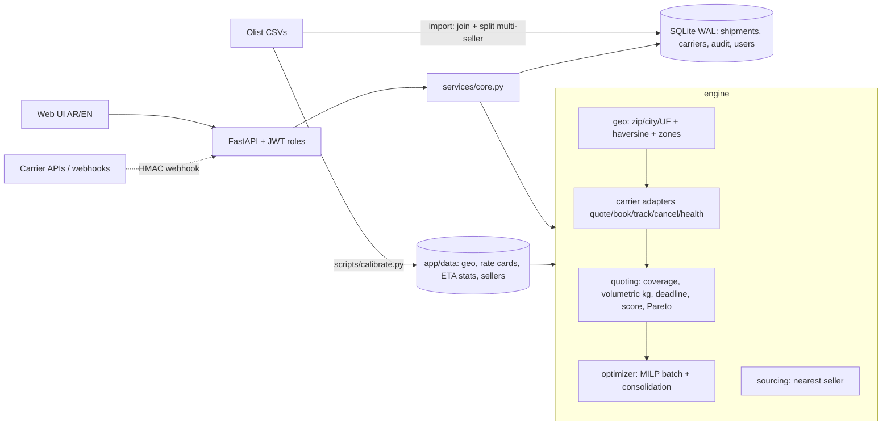

# Olist Logistics Optimizer

نظام لتحسين الشحن والتوصيل لـ Olist: بيقارن شركات الشحن على **المسار الفعلي** (من/إلى)، بيختار **أقرب مصدر (seller)**، بيحسب **السعر** و**الوقت (P50/P90)** و**احتمال التأخير** لكل شركة، وبيعمل **optimization** لكل أوردر ولمجموعة أوردرات مع قيود السعة.

> Carrier prices/ETAs are **simulated but calibrated on the real Olist 2016-2018 data** (not live carrier prices). See *Assumptions*.

## Quick start
```bash
python -m venv .venv && source .venv/bin/activate        # Windows: .venv\Scripts\activate
pip install -r requirements.txt
cp .env.example .env                                      # set JWT_SECRET / ADMIN_PASSWORD (or let it generate and log them)
uvicorn app.main:app --reload                             # http://127.0.0.1:8000  (API docs: /docs)
```
Load the real data (put the Olist CSVs in `./olist_data`, or unzip `archive.zip` there):
```bash
python scripts/import_olist.py --data ./olist_data        # ~100k sub-shipments in ~10 s (bulk insert)
```
First start creates the `admin` user. If `ADMIN_PASSWORD` is empty a random password is printed once in the log. Demo users (`operator/operator123`, `viewer/viewer123`) exist only with `SEED_DEMO_USERS=true`.

Docker: `docker compose up --build` (mount the CSVs in `./olist_data`).

## Architecture / data flow

- `app/engine/geo.py` – resolves zip prefix / `City, UF` / UF, haversine distance, 5 distance zones.
- `app/engine/carriers.py` – profile per carrier (coverage by state, multipliers, fuel, insurance, volumetric divisor, max weight, capacity) + **adapter interface** (`quote/book/track/cancel/health`), circuit breaker. `SimulatedAdapter` is calibrated; `LiveCarrierAdapter` is the template for Correios / Jadlog / Melhor Envio.
- `app/engine/quoting.py` – per-order optimisation: coverage filter → price (zone rate card × max(actual, volumetric kg) + fuel + insurance) → ETA P50/P90 from real state-pair stats (shrunk to zone stats when sparse) → late-risk (lognormal) → deadline feasibility → weighted score (cost / speed / reliability / custom) → Pareto frontier + explanation per carrier.
- `app/engine/optimizer.py` – batch assignment as a MILP (HiGHS via SciPy) with per-carrier capacity, compared against random/cheapest/fastest baselines; consolidation of parcels from the same origin to the same state.
- `app/engine/sourcing.py` – ranks candidate sellers for a product by distance, handling time, price and ETA.
- `app/services/core.py` – shipments lifecycle (state machine), assign/book (price re-quoted server-side), reroute, tracking, KPIs, analytics. `importer.py` – Olist import.

## What changed vs the MVP (your list)
| # | Problem / request | Now |
|---|---|---|
| 1-3 | quotes ignored the route; coverage unused; fixed ETA | quotes use real origin/destination (distance → zone), coverage per carrier removes uncovered carriers (with the reason), ETA from real state-pair history |
| 4 | price = base + kg | zone rate card + volumetric weight + fuel + insurance (+ regional adjustments), BRL |
| 5 | no nearest source | `POST /api/sourcing/rank` (sellers that sold the product before) |
| 6-7 | random balanced score / no optimization | normalised weighted score, weights validated, 422 on bad objective; per-order + batch MILP + Pareto |
| 8 | quote never became a shipment | `POST /api/shipments/{id}/assign` books (re-quotes server-side, stores price/ETA/tracking) |
| 9 | deadline unused | deadline drives eligibility (P90 by default), slack, late-probability, infeasibility report |
| 10-15 | weak import | joins items/products/sellers/customers/geolocation, real origin/destination/weight/volume, status mapping, bulk `executemany`, **1,278 multi-seller orders split into sub-shipments** |
| 16-18 | free-text status/carrier | enums (422), state machine `Pending→Booked→In Transit→Delivered`, `Canceled` only from Pending/Booked, carrier FK |
| 19-20 | no pagination; KPIs from filtered list | `limit/offset/total`; `/api/kpis` over the whole table |
| 21-22 | no currency; hard delete | BRL everywhere; soft delete + restore + `audit_log` |
| 23-26 | no auth / limits / tests | JWT + roles (admin/operator/viewer), upload cap + zip-bomb cap, CSV-injection guard, rate limit, CORS allow-list, structured logs, `/metrics`, tests |
| 27-28 | init at import; SQLite untuned | lifespan init, versioned migrations, WAL + indexes + FKs |
| 29-30 | one-file UI; loose deps; no Docker | split `index.html/app.js/styles.css/i18n.js`, Arabic/English + RTL, pinned deps, Dockerfile, compose, CI |

**Not done (on purpose):** Postgres (the code targets SQLite/WAL; moving to Postgres means a SQL dialect layer), Alembic (a small versioned-migration runner is used instead), real carrier APIs (adapter template only), live webhooks from real carriers (HMAC-signed endpoint is ready; tracking is simulated).

## Assumptions (read before presenting)
1. Olist has **no inventory data** → candidate sellers for a product = sellers that sold it before.
2. Carrier tariffs/ETAs are **simulated**: a zone rate card and ETA statistics are fitted on orders **before 2018-01-01**; per-carrier multipliers (price/speed/reliability/coverage) are assumptions that create realistic differences.
3. Origin/destination are zip-prefix centroids (Olist anonymises addresses): distances are approximate (±~10 km).
4. Parcel dimensions of a multi-item sub-shipment are approximated by a cube of the summed volume.
5. Late risk assumes lognormal transit time fitted to (P50, P90).

## Backtest (hold-out 2018, `scripts/backtest.py`, shown in the UI)
Models calibrated on pre-2018 orders; 5,000 unseen 2018 sub-shipments evaluated, deadline = the date Olist actually promised.

| Policy | Avg cost (BRL) | ETA P50 (d) | Expected late rate |
|---|---|---|---|
| Random carrier | 22.63 | 9.95 | 11.0% |
| Status quo (single carrier) | 21.77 | 10.01 | 10.7% |
| Always cheapest | 17.39 | 10.47 | 12.0% |
| Always fastest | 31.37 | 7.47 | 4.6% |
| **System: cheapest that meets deadline** | **21.51** | **9.13** | **6.6%** |
| **System: balanced** | 25.56 | 8.31 | 5.1% |

Reading: with the deadline as a constraint the system keeps cost ≈ status quo (−1.2%) while cutting the expected late rate by ~4 pp and the ETA by ~0.9 day; the *balanced* mode buys a bigger improvement (−5.6 pp late, −1.7 days) for +17% cost. "Always cheapest" is cheaper but increases lateness: the trade-off is explicit, not hidden.
Model accuracy on hold-out: price R² ≈ 0.45 (MAE ≈ R$ 7.2); ETA P90 coverage ≈ 88% (target 90%), P50 coverage ≈ 56% (slightly conservative).
Nearest source (1,000 single-item orders of multi-seller products): the system picks a different seller in ~54% of orders; average distance 553 → 465 km (−16%), price R$ 16.1 → 15.2, ETA 9.2 → 8.7 days — under the no-inventory assumption.
> These gains are measured **inside the simulated carrier universe**. They show the optimizer logic works and how trade-offs behave; they are not a claim about real carrier contracts.

## 3-minute demo
1. **Compare** → São Paulo → Manaus, 2.5 kg, 30×20×15, deadline **35 days**: Gamma/Delta disappear (no coverage); Epsilon is recommended; see price, P50/P90, late risk, "why", map and Pareto chart. Then try deadline **20**: nothing is eligible (the best carrier's P90 is ~30 d) and the response says so (`infeasible`) — a good way to show the deadline is a real constraint.
2. **Nearest source** → pick a multi-seller product, destination Salvador → ranked sellers by distance/price/ETA.
3. **Shipments** → create a shipment → *Assign* → choose a carrier → status **Booked** with tracking code.
4. **Carriers** → *Simulate outage* on the chosen carrier → open the shipment → *Re-route?* shows the fallback alternatives.
5. **Batch optimizer** → 300 Pending orders, cost objective → MILP plan, a like-for-like table vs random/cheapest/fastest (same orders only), and **an explicit reason for every unassigned order** (`NO_COVERAGE`, `DEADLINE_INFEASIBLE`, `CARRIERS_UNAVAILABLE`, `CAPACITY`). Tick *Relax impossible deadlines* to assign them anyway, flagged as at risk.
6. **What-if** → move the cost↔speed slider; **Backtest** page → evidence on 2018 data.

## Batch optimizer: how to read the result
- `optimized` / `baselines` totals can cover **different numbers of orders**; compare policies with `baselines.<policy>.vs_optimized`, which only uses orders both policies assigned. **Negative = the optimized plan is better** (cost / ETA / expected late orders). In `balanced` mode the plan usually costs *more* than cheapest-greedy (positive `cost_change_pct`) in exchange for fewer late orders — that is the trade-off, not a bug.
- `unassigned[]` carries `reason_code` + a human `reason`; `unassigned_summary` counts them. `relax_deadline=true` assigns deadline-infeasible orders anyway (`relaxed: true`; `apply` books them with `deadline_at_risk` in the audit log).

## Tests
```bash
pip install -r requirements-dev.txt && pytest -q
```
`tests/test_engine.py` (geo, pricing, volumetric weight, coverage, deadline, optimizer capacity, outage fallback, sourcing), `tests/test_services.py` (state machine, lifecycle + audit, soft delete, pagination/KPIs, capacity, reroute, webhook, CSV-injection, JWT), `tests/test_api.py` (auth/roles, 422 validation, lifecycle over HTTP, HMAC webhook + disabled-webhook, batch reasons/relax/apply), `tests/test_config.py` (secret checks, production guard).

## Re-calibrating / re-running the backtest
```bash
python scripts/calibrate.py --data ./olist_data           # regenerates app/data/*
python scripts/backtest.py  --data ./olist_data           # regenerates app/data/backtest.json
```
## Security notes
`cp .env.example .env` is read automatically (real env vars win). Set `JWT_SECRET` (>=32 chars), `ADMIN_PASSWORD`, `WEBHOOK_SECRET` (>=16 chars); placeholders starting with `change-me` count as unset. **The tracking webhook returns 503 until a real `WEBHOOK_SECRET` is set** (an empty HMAC key would let anyone forge tracking events). With `APP_ENV=production` the app refuses to start on weak/missing secrets or demo users; in development it only logs warnings. Run behind HTTPS; the rate limiter is in-process (use a proxy/Redis limiter for multiple workers). Tokens live in `sessionStorage`.
